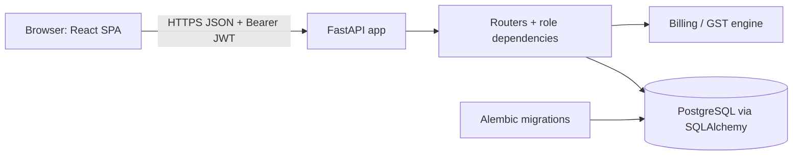
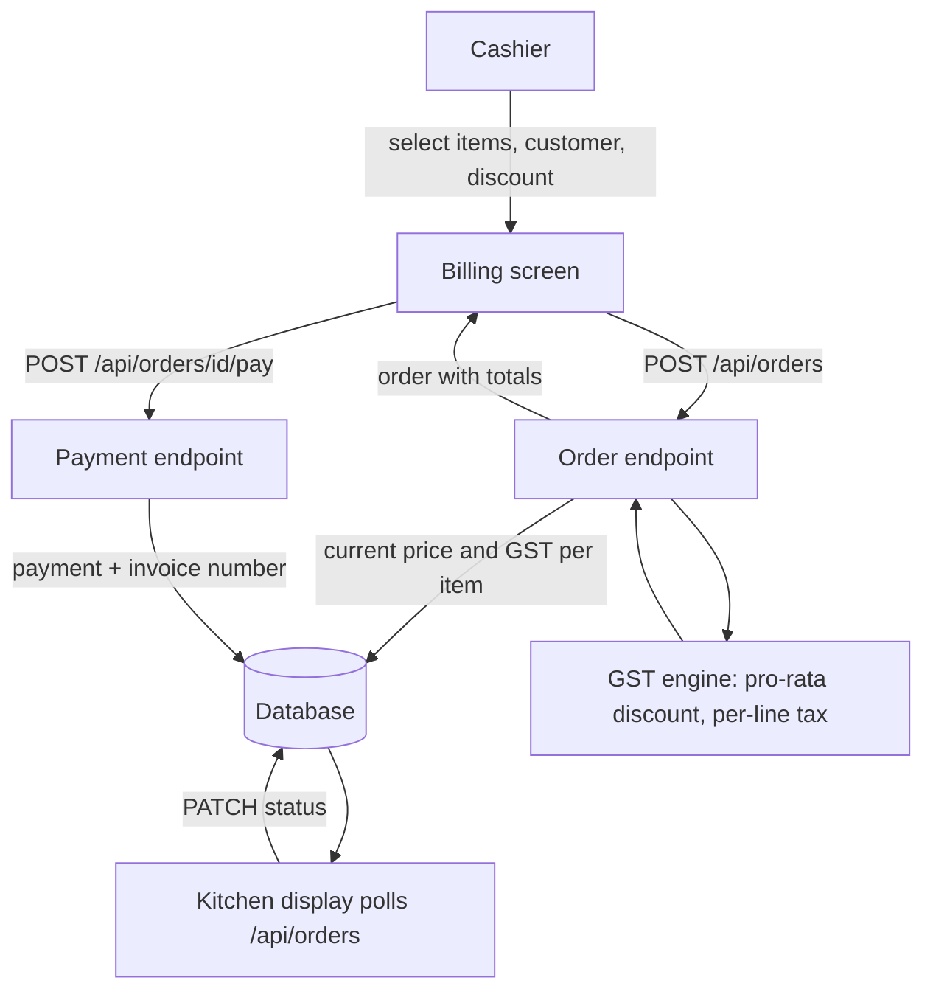
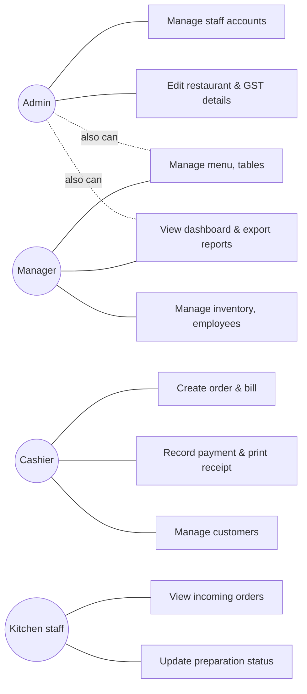

# RestaurantPOS – Smart Restaurant Point of Sale and Management System

## 1. Overview
RestaurantPOS is a web application that lets a restaurant's admin, manager, cashiers and kitchen staff run daily operations from one system: billing with GST, kitchen order flow, menu, tables, inventory, customers, employees and sales reporting.

## 2. Problem statement
Small restaurants often run billing on paper or a generic till, track stock in notebooks, and pass orders to the kitchen verbally. This causes billing and tax errors, slow service, unnoticed stock-outs and no sales visibility. They need a low-cost integrated system with GST-correct invoices and role-based access.

## 3. Objectives
1. Fast cashier billing with accurate, auditable GST (CGST/SGST/IGST).
2. A kitchen display that shows incoming orders and lets staff update status.
3. Role-based access enforced on the server (admin, manager, cashier, kitchen).
4. Inventory, customer and employee records.
5. Sales dashboard and CSV/PDF reports.
6. Secure by default: hashed passwords, JWT, input validation, audit log.

## 4. Scope
**In scope (implemented):** see `FEATURE_CHECKLIST.md`.
**Out of scope / not implemented:** real payment gateway (payments are simulated), thermal-printer hardware integration (receipts use the browser print dialog), online-ordering platform integration, multi-branch support, HSN/SAC codes, an inter-state (IGST) toggle on the billing screen.

## 5. Technology stack
React 18 + TypeScript + Vite + Tailwind CSS + Zustand + React Router + Axios + Recharts + Lucide (frontend); Python 3.12 + FastAPI + Pydantic + SQLAlchemy 2 + Alembic + PyJWT + bcrypt + ReportLab (backend); PostgreSQL (SQLite for local development/tests); Docker Compose; pytest.

## 6. System architecture

The kitchen display subscribes to a WebSocket and reloads orders when notified. Layers: React pages call the REST API through one Axios client; each router validates input with Pydantic, checks the role with a dependency, runs the database transaction, and writes an audit-log entry for sensitive actions. GST maths lives in one module (`app/billing.py`) using `Decimal`.

## 7. Data flow (billing)

Prices and tax rates are read from the server at order time; the browser never sets totals.

## 8. Use cases

Admin inherits all manager permissions; managers also have cashier abilities.

## 9. Database design
See `ER_DIAGRAM.md` (generated from the models). Money columns use `NUMERIC(12,2)`; stock uses `NUMERIC(12,3)`. Orders snapshot item name, unit price and GST rate so later menu edits don't change past invoices.

## 10. GST method
Prices are GST-exclusive. Discount is distributed pro-rata across lines; tax = (line value − its discount share) × rate, rounded half-up to 2 decimals per line. For intra-state sales tax splits into CGST and SGST (SGST takes any odd paisa); for inter-state sales the full amount is IGST. This is a reasonable implementation but **should be verified by a qualified accountant before real use**; HSN/SAC codes, composition scheme and service-charge rules are not modelled.

## 11. Security
bcrypt password hashing; short-lived JWT (default 30 min); every endpoint except login requires a token; role checks on the server; Pydantic validation; SQLAlchemy parameterised queries; CORS limited to configured origins; secrets from environment variables; audit log for logins, payments, user/settings changes. Access tokens last 30 minutes; refresh tokens (7 days) are random, stored only as SHA-256 hashes, rotated on every use, and revoked on logout, password change or deactivation; replaying a used refresh token revokes all of that user's sessions. Failed logins are limited (5 per account or 20 per IP per 15 minutes, HTTP 429), and responses carry security headers; the app refuses to start on PostgreSQL with the default dev JWT secret. Known gaps: the limiter is in-memory (single process, resets on restart); tokens are kept in sessionStorage (readable by injected scripts, so XSS must be prevented); no HTTPS in the dev setup; no two-factor authentication.

## 12. Limitations
Kitchen updates use a single in-process WebSocket channel: it works with one backend process only (multiple workers would need Redis pub/sub), and it signals 'reload' rather than sending order data. Recipe-based stock deduction can drive stock negative (shown as low) rather than blocking a sale.  Payments are simulated. Frontend automated tests cover only login, billing and role navigation. Docker files are unverified. Product images are stored on local disk (not cloud storage) and are not resized.

## 13. Future enhancements
HSN codes and an inter-state billing toggle; shared rate limiting (Redis) for multi-process deployment; thermal printer support; payment gateway integration; multi-branch; frontend and end-to-end tests.
